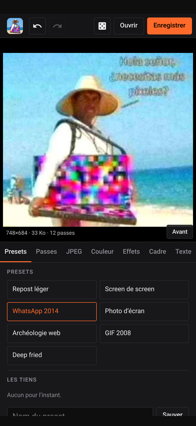
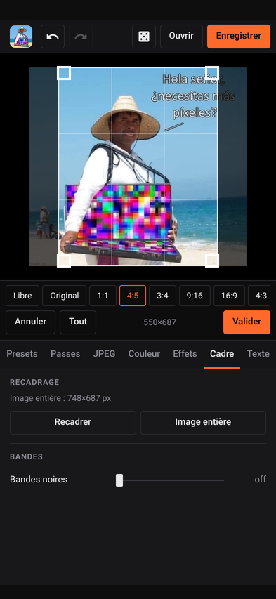
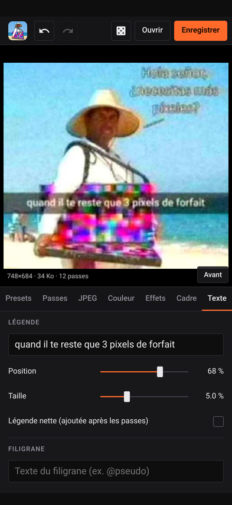

<p align="center"></p>

<h1 align="center">Recompresseur</h1>

An Android app that degrades images on purpose, so they look like a screenshot that was re-shared, re-saved and
re-compressed a hundred times, with a live preview.

It works fully offline: the app has no internet permission, so your images never leave the phone.

> The interface is currently in French.

<p align="center">
  
  
  
</p>

## Download

Grab the APK from the [latest release](../../releases/latest) and open it on your phone (you may have to allow
installs from your browser or file manager).

## Features

- **Live preview** while you tweak, with a fast low-res draft during a drag and a sharp render when you let go.
  Hold **Avant** to see the original, tap the image to zoom in.
- **Undo / redo** for every change (sliders, presets, crop, text…)
- **Presets**: "Screen of a screen", "2014 WhatsApp group", "Photo of a screen", "Internet archaeology",
  "2008 GIF", "Deep fried"… You can also save your own.
- **Passes**: number of re-compressions, cropping and rotation per pass, optional pixelated look
- **JPEG**: min/max quality, how much the image shrinks per pass, final quality
- **Color**: saturation, contrast, brightness, washed-out blacks, yellowing
- **Effects**: color bleeding, posterization, oversharpening halos, blur, noise, moiré
- **Crop**: free or fixed ratio (1:1, 4:5, 3:4, 9:16, 16:9, 4:3), applied to the original before the passes
- **Text**: a Snapchat-style caption bar (degraded with the image, or added clean at the end) and a watermark
- **Frame**: black bars
- **Share target**: share any image from another app straight into Recompresseur. Saved images go to
  `Pictures/Recompresseur`.

Sliders only move when you drag horizontally, so scrolling the panel doesn't nudge them by accident.
Double-tap a slider row to reset it.

## Build

### With GitHub Actions

Every push to `main` builds the APK. Open the **Actions** tab, pick the latest run and download the
`Recompresseur` artifact.

By default, each run signs the APK with a new throwaway key, so you have to uninstall the old version before
installing a new one. To install updates over the previous version, add these repository secrets under
**Settings → Secrets and variables → Actions**:

| Secret | Value |
| --- | --- |
| `KEYSTORE_BASE64` | your keystore file, base64-encoded (`base64 -w0 your.keystore`) |
| `KS_PASS` | keystore password |
| `KS_ALIAS` | key alias |

### Locally (Debian/Ubuntu, no Gradle)

```sh
sudo apt install aapt apksigner dalvik-exchange android-sdk-platform-23 zipalign
./build.sh
```

The APK lands in `build/Recompresseur.apk`. The first build creates a `recomp.keystore` signing key. Keep it
private and reuse it for every build, because Android only installs an update if it's signed with the same key.
It's ignored by git.

## How it works

The whole editor is a single HTML/JS page (`assets/index.html`) that runs in a WebView and uses the WebView's
own JPEG encoder for every pass (`canvas.toDataURL`, which is synchronous: `canvas.toBlob` waits for the WebView
to go idle and made renders stall). The Java side (`src/app/recompresseur/MainActivity.java`) handles opening and
sharing images and saving the result.
